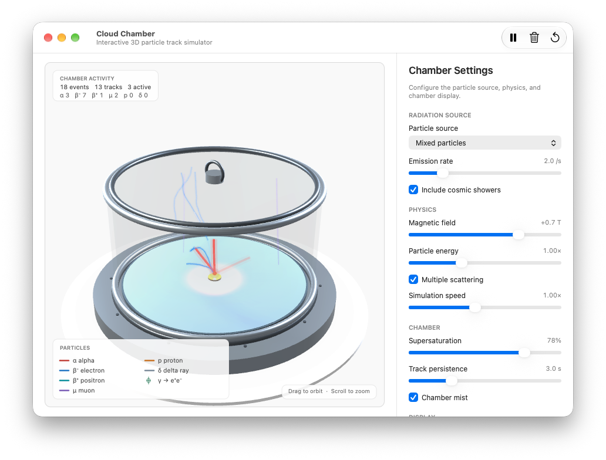

# Cloud Chamber

A native macOS cloud-chamber simulator built with Swift, AppKit, and SceneKit. It presents an
interactive 3D glass chamber with live particle tracks.



## Features

- Interactive 3D chamber with orbit and zoom camera controls.
- Animated alpha, beta, muon, proton, gamma-conversion, delta-ray, and cosmic-shower tracks.
- Three-dimensional magnetic curvature, multiple scattering, track persistence, and fading.
- Live inspector controls for the particle source, physics, chamber, and display settings.
- Particle legend, live statistics, mist, and a glowing source.
- Pause/resume, clear tracks, camera reset, and restore-defaults actions.
- JSON configuration export and import.
- Settings persist between launches through UserDefaults.

## Controls

- **Drag** in the 3D view to orbit the camera.
- **Scroll** to zoom.
- **Pause/Resume:** Space or the toolbar button.
- **Clear tracks:** ⌘K or the toolbar button.
- **Restore defaults:** ⌘R or the toolbar button.
- **Reset Camera**, **Export Config…**, and **Load Config…** are available in the inspector's
  Actions section.

## Build

Requirements: macOS 14 or newer, Xcode, and [XcodeGen](https://github.com/yonaskolb/XcodeGen).

```sh
xcodegen generate
xcodebuild -project CloudChamber.xcodeproj -scheme CloudChamber -configuration Debug \
  -derivedDataPath .build CODE_SIGNING_ALLOWED=NO build
open .build/Build/Products/Debug/CloudChamber.app
```

## Test

```sh
xcodebuild test -project CloudChamber.xcodeproj -scheme CloudChamber \
  -destination 'platform=macOS' -derivedDataPath .build CODE_SIGNING_ALLOWED=NO
```

## Project layout

```text
CloudChamber/
├── AppDelegate.swift       App lifecycle, menus, window ownership
├── UI/                     Window, inspector, overlays, and SceneKit rendering
├── Model/                  Configuration, chamber geometry, and particle types
└── Simulation/             Seeded RNG, physics, and the simulation engine
```
